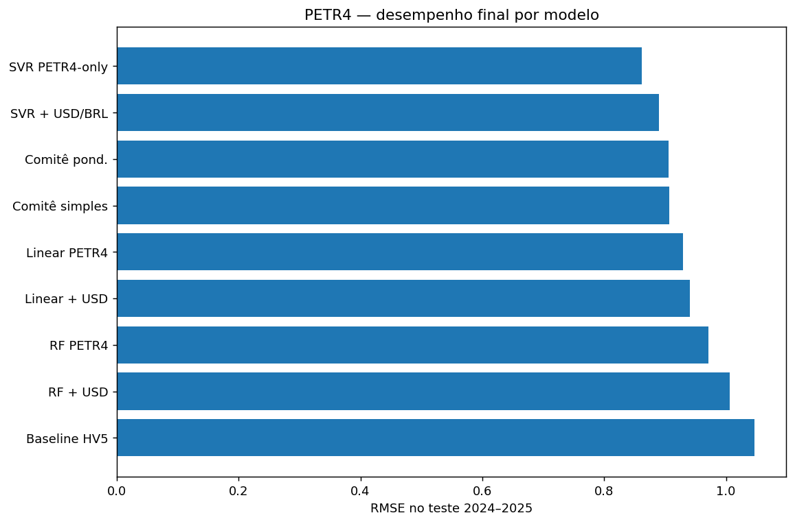
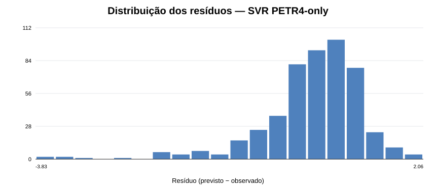

# Aprendizado de Máquina — Portfólio de Pesquisa Aplicada

Projetos independentes de **análise e pesquisa aplicada**, com foco em Machine Learning, Deep Learning, séries temporais financeiras e previsão de volatilidade.

O objetivo é apresentar o **problema, os dados, a metodologia, os resultados e as limitações** de cada experimento, com ênfase em comparação com baselines, avaliação temporal e prevenção de *data leakage*.

## Estudos de caso — PETR4 intradiária

Três estudos resumidos de **pesquisa aplicada independente**: métricas, gráficos em português e interpretação profissional, sem disponibilizar o notebook completo ou as bases históricas.

| Estudo | Conteúdo |
|---|---|
| [Machine Learning e referências históricas](estudos/petr4_intradiario/01_baselines_e_ml.md) | Regressão Gamma, EWMA, Floresta Aleatória e XGBoost |
| [Deep Learning em séries temporais](estudos/petr4_intradiario/02_deep_learning.md) | LSTM, GRU, TCN e Transformer causal |
| [Ensembles e robustez](estudos/petr4_intradiario/03_ensembles_e_robustez.md) | ENS50, estabilidade por períodos e medidas alternativas |

[**Visão geral dos três estudos**](estudos/petr4_intradiario/README.md)

> Resultados exploratórios: prever volatilidade não equivale a prever a direção do preço ou obter rentabilidade.

## Evidências do experimento

Os dois gráficos a seguir foram **extraídos das saídas do notebook publicado**, sem recalcular métricas ou criar resultados sintéticos.

### Comparação de desempenho — PETR4



**Leitura:** o RMSE compara a magnitude dos erros dos modelos e do baseline no conjunto de teste. Valores menores indicam menor erro na métrica apresentada, mas não comprovam rentabilidade financeira nem superioridade em outros períodos.

### Diagnóstico dos resíduos



**Leitura:** a distribuição dos resíduos ajuda a investigar erros sistemáticos, dispersão e valores extremos, complementando MAE e RMSE. O gráfico não substitui validação temporal ou testes adicionais de robustez.

[Consultar o notebook do projeto histórico](01_previsao_volatilidade/03_AM_PETR4_USDBRL.ipynb)

## Outros projetos publicados

### 01 — Previsão da volatilidade futura da PETR4 e do USD/BRL
**Área:** Machine Learning aplicado a dados financeiros  
**Estado:** experimento clássico documentado; históricos públicos obtidos automaticamente, com triagem inicial identificada separadamente.

[Ver notebook e documentação](01_previsao_volatilidade/README.md) · [Abrir notebook](01_previsao_volatilidade/03_AM_PETR4_USDBRL.ipynb)

**Objetivo:** avaliar modelos supervisionados para estimar a volatilidade realizada nos cinco pregões seguintes.

**Métodos:** baseline de volatilidade histórica, regressão linear, SVR, Random Forest, ensembles e testes de estabilidade. O estudo inclui validação temporal e separação de dados de desenvolvimento e teste.

O notebook foi transferido do repositório `Analise-de-Dados` **sem alterar suas células, resultados ou gráficos**.

## Estudos adicionais em desenvolvimento

A previsão de volatilidade diária constitui outra investigação, com alvo e protocolo próprios. Não se confundem esses resultados com a coleção intradiária.

## Estrutura

```text
Aprendizado-de-Maquina/
├── 01_previsao_volatilidade/
│   ├── 03_AM_PETR4_USDBRL.ipynb
│   ├── README.md
│   └── dados/
│       └── README.md
├── requirements.txt
├── .gitignore
├── LICENSE
└── README.md
```

## Execução

Instale dependências com `python -m pip install -r requirements.txt`. Abra o notebook **na pasta do trabalho**: a primeira célula prepara automaticamente os históricos públicos de PETR4, BCB PTAX e FRED. Também é possível executar `python obter_dados.py` nessa pasta. Os arquivos originais da triagem de candidatos não foram recuperados: sem eles, a seleção histórica permanece uma decisão fixa documentada, não uma nova execução da busca. Resultados podem variar com revisões das APIs, e a coleta depende da disponibilidade e das condições dos provedores.

## Princípios metodológicos

- Divisão temporal e prevenção de vazamento de informação
- Transformações ajustadas exclusivamente nos dados de treino
- Comparação com referências simples (*baselines*)
- Registro das escolhas, das métricas e das limitações
- Divulgação apenas de resultados validados, diferenciando pesquisa em curso de trabalho concluído

**Tecnologias:** Python, Pandas, NumPy, Scikit-learn, Matplotlib e Jupyter.

---
**Autor:** Álvaro Bonifácio · pesquisa aplicada e projetos independentes

**Licença:** o código do repositório está sob MIT; bases de terceiros mantêm suas respectivas condições de uso.
