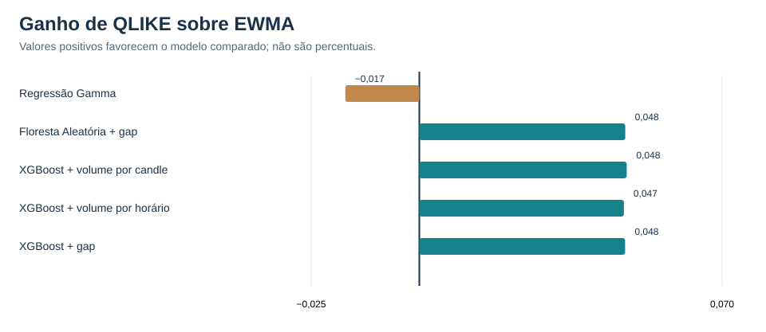
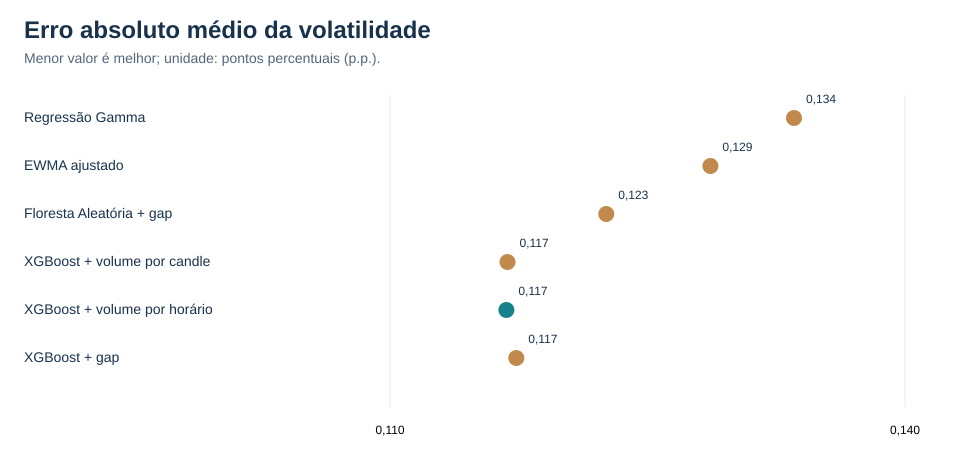

# 01 — Machine Learning e modelos históricos

[← Coleção PETR4 intradiária](README.md)

## Desafio

Prever a **variância realizada dos 60 minutos seguintes (RV60)** da PETR4, avaliando se modelos de árvores melhoram métodos de referência históricos.

## Modelos e ajustes

| Modelo | Configuração efetiva |
|---|---|
| **Regressão Gamma sazonal (B5)** | Janela móvel de 500 pregões e dois harmônicos de Fourier; coeficientes ajustados no treinamento |
| **EWMA dessazonalizado (B6-OPT)** | Meia-vida de 48 observações, selecionada por validação temporal |
| **Floresta Aleatória + gap (RF-A4)** | Atributos de candles, volume, horário e abertura; hiperparâmetros previamente selecionados |
| **XGBoost + volume por candle (A2)** | Objetivo Tweedie e configuração C05 previamente selecionada |
| **XGBoost + volume por horário (A3)** | A2 mais atributos de volume por horário |
| **XGBoost + gap de abertura (A4)** | A3 mais gap conhecido na origem da previsão |

As denominações originais de “padrão” se referiam a **configurações de referência**, e não necessariamente a hiperparâmetros de fábrica. Nos cenários A2–A4, mantivemos a configuração C05, variando os atributos.

## Resultados

| Modelo | QLIKE ↓ | MSE RV60 (×10⁻⁹) ↓ | MAE volatilidade (p.p.) ↓ |
|---|---:|---:|---:|
| Gamma (B5) | −9,928681 | 1,279881 | 0,133535 |
| EWMA (B6-OPT) | −9,945795 | 1,339187 | 0,128665 |
| Floresta Aleatória + gap | −9,993405 | 1,176482 | 0,122598 |
| XGBoost + volume por candle | **−9,993734** | 1,191582 | 0,116845 |
| XGBoost + volume por horário | −9,993084 | 1,190704 | **0,116781** |
| XGBoost + gap | −9,993367 | **1,167698** | 0,117357 |

## Conclusão

O **XGBoost A2** liderou em QLIKE, o **A4** em MSE e o **A3** em MAE da volatilidade. A escolha do modelo depende do objetivo e da métrica.

**Competências demonstradas:** Python, séries temporais, engenharia de atributos, Floresta Aleatória, XGBoost, seleção de hiperparâmetros, validação cronológica e interpretação de resultados.

**Avaliação:** 480 pregões e oito blocos temporais, com seleção e comparação de diferentes configurações.