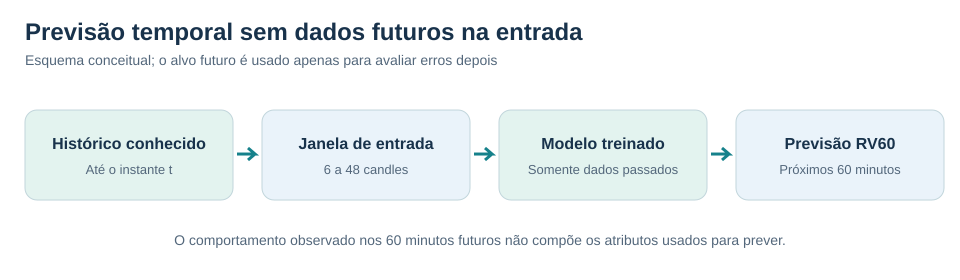
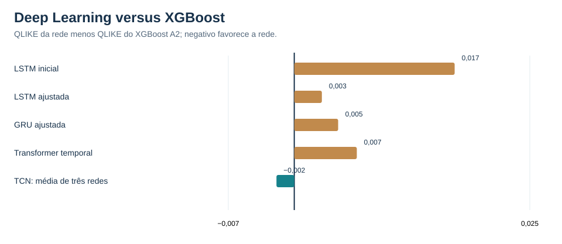
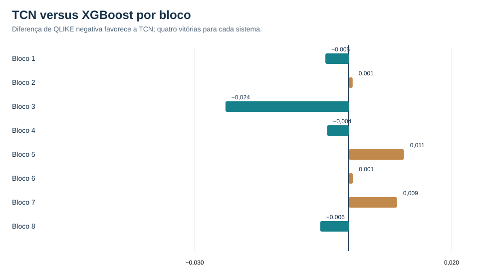

# 02 — Deep Learning para séries temporais

[← Coleção PETR4 intradiária](README.md)

## Desafio

Comparar redes neurais sequenciais com XGBoost na previsão de **RV60**, respeitando a ordem temporal e evitando usar informações futuras nas entradas.

## Arquiteturas testadas

| Modelo | O que foi executado |
|---|---|
| **LSTM inicial** | Janela de 24 candles, camada de 16 unidades e até 14 épocas; configuração de referência |
| **LSTM ajustada (LSTM-OPT)** | Seis configurações de janela e capacidade selecionadas por validação temporal |
| **GRU compacta** | Seleção interna de configuração e múltiplas sementes |
| **Transformer temporal** | Treinado do zero, com atenção causal e cinco candidatos |
| **TCN — média de três redes (TCN-ENS3)** | Convoluções causais com ajustes internos; previsão final é **média de três redes**, não uma TCN individual |

## Comparação

| Sistema | QLIKE ↓ | MSE RV60 (×10⁻⁹) ↓ | MAE volatilidade (p.p.) ↓ |
|---|---:|---:|---:|
| XGBoost + volume por candle | −9,993734 | 1,191582 | 0,116845 |
| LSTM inicial | −9,976711 | 1,210629 | 0,125852 |
| LSTM ajustada | −9,990804 | 1,158179 | 0,117449 |
| GRU compacta | −9,989077 | 1,156942 | 0,119280 |
| Transformer temporal | −9,987094 | 1,181690 | 0,119414 |
| **TCN — média de três redes** | **−9,995623** | **1,132929** | **0,114774** |

## Conclusão

A **TCN-ENS3** liderou na avaliação agregada, mas teve QLIKE menor que XGBoost em apenas **quatro dos oito blocos**. A análise exploratória por pregão não confirmou superioridade estatística (**HAC(10), p = 0,6238**).

**Competências demonstradas:** Python, PyTorch, LSTM, GRU, TCN, Transformer causal, engenharia de sequências, validação temporal e análise crítica.

O resultado apresentado para TCN corresponde à **média de três redes**, uma abordagem de combinação de previsões.