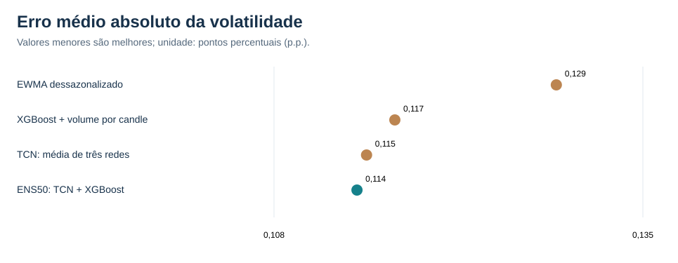
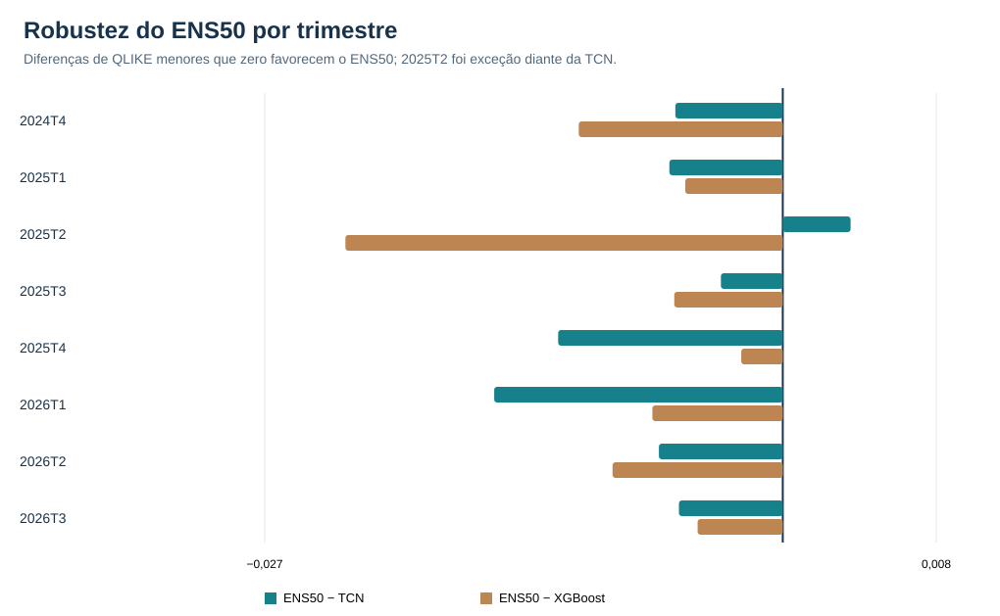
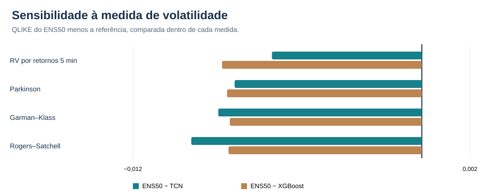
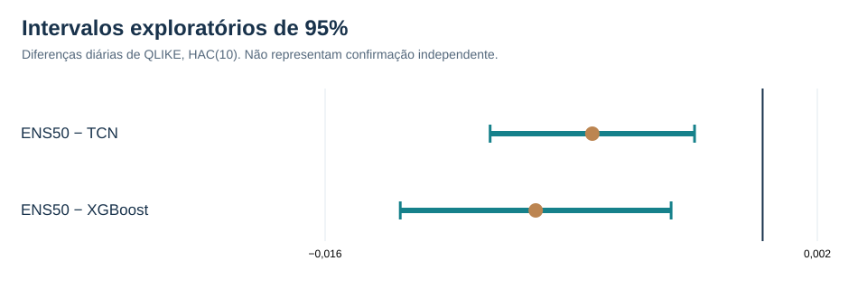

# 03 — Ensemble e robustez temporal

[← Coleção PETR4 intradiária](README.md)

## Desafio

Verificar se uma combinação simples melhora a previsão da **variância realizada dos próximos 60 minutos (RV60)** e se o ganho se mantém em diferentes períodos.

**ENS50 = 50% da previsão da TCN-ENS3 + 50% da previsão do XGBoost A2**, na escala de variância. A TCN-ENS3 já é a média de três redes distintas. Os pesos 50/50 não foram otimizados retrospectivamente nesta etapa.

## Resultado dos sistemas

| Sistema | QLIKE ↓ | MSE RV60 (×10⁻⁹) ↓ | MAE volatilidade (p.p.) ↓ |
|---|---:|---:|---:|
| **ENS50 — TCN + XGBoost** | **−10,001981** | 1,137154 | **0,114073** |
| TCN — média de três redes | −9,995623 | **1,132929** | 0,114774 |
| XGBoost + volume por candle | −9,993734 | 1,191582 | 0,116845 |
| EWMA dessazonalizado | −9,945795 | 1,339187 | 0,128665 |

## Estabilidade e sensibilidade

A QLIKE do ENS50 foi menor que a TCN em **7/8 blocos** e menor que o XGBoost em **8/8 blocos**. A exceção foi **2025T2**, em que a TCN venceu o ensemble.

As previsões também foram avaliadas com medidas alternativas da volatilidade: RV por retornos, Parkinson, Garman–Klass e Rogers–Satchell.

Comparações locais com HAC(10) produziram diferenças médias diárias de QLIKE de **−0,006228** versus TCN e **−0,008299** versus XGBoost.

## Conclusão

O **ENS50** apresentou a melhor QLIKE e o menor MAE nesse histórico; a **TCN liderou em MSE**. O ganho não foi uniforme ao longo do tempo e exige quatro modelos treinados (três TCN e um XGBoost).

**Competências demonstradas:** ensembles, validação temporal, comparação de métricas, análise por regime, testes de sensibilidade, gráficos e interpretação estatística.

**Interpretação:** a análise exploratória permite comparar modelos e períodos, mas a estabilidade futura depende de novas condições de mercado.